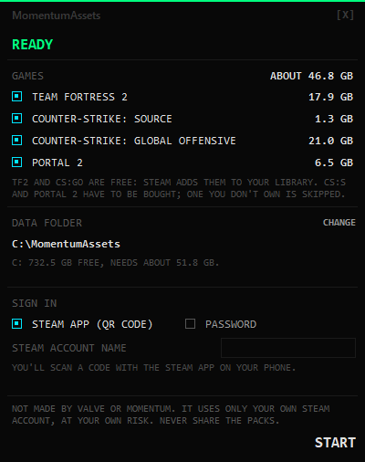
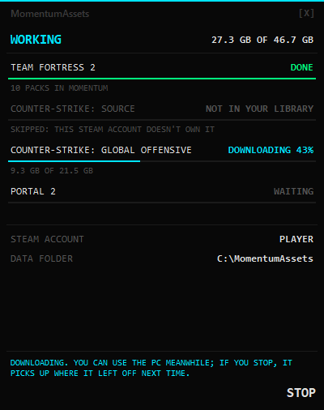

# MomentumAssets

Gives [Momentum Mod](https://momentum-mod.org) the textures, models and sounds its maps borrow
from **Team Fortress 2**, **Counter-Strike: Source**, **Counter-Strike: Global Offensive** and
**Portal 2**, without installing those games.

Many Momentum maps, in every game mode, use things from those four games. Without them you get
purple-and-black checkerboards and missing models. Installing all four games takes about 86 GB.
MomentumAssets downloads only the parts Momentum uses (about 48 GB) and puts them where Momentum
looks for them.

## Download

1. Open the [latest release](../../releases/latest) and download **MomentumAssets.exe**.
2. Put it anywhere you like, for example in Documents, and double-click it.
3. The first time, Windows may say **"Windows protected your PC"**. Click **More info**, then
   **Run anyway**.

Why Windows says that: the .exe isn't signed with a paid certificate, which small free projects
like this one usually don't have, so Windows doesn't know it yet. The .exe is built by GitHub
from the code on this page, and each release says which commit it came from. Its checksum is in
`SHA256SUMS.txt` beside it. Some antivirus programs are wary of programs packed this way too; if
yours is, use the Python way below instead.

### Or with Python

Click the green **Code** button at the top of this page, then **Download ZIP**, unzip it
anywhere, and double-click **Momentum Assets.bat**. It needs Python, and offers to install it
for you if your PC doesn't have it. It opens the same window.

## What you need

- **Windows** 10 or 11.
- **Momentum Mod**, installed through Steam.
- **Your own Steam account.** TF2 and CS:GO are free, and Steam adds them to your library for
  you. CS:S and Portal 2 have to be bought; any you don't own are skipped.
- **About 50 GB of free space**: 48 GB to download, 47 GB kept, and about 2.5 GB of room to
  work in.
- **The Steam app on your phone** to sign in with a QR code, or your Steam password and Steam
  Guard code.

## How to use it

1. Open MomentumAssets (see [Download](#download)).
2. Tick the games you want, check the folder, choose how to sign in, and click **START**.
3. Sign in to Steam:
   - **QR code:** open the Steam app on your phone, tap the shield (Steam Guard), tap
     *Scan a QR code*, point it at the code in the window, and approve.
   - **Password:** a Steam sign-in box opens. Type your password there, then approve on your
     phone or type the Steam Guard code Steam sends you.
4. Wait while it downloads. You can use your PC meanwhile. With fast internet, all four games
   take about half an hour.
5. When it says **DONE**, start Momentum and play.

Momentum has to be closed when the packs go in; if it's running, MomentumAssets waits for you to
close it. You can stop at any time: next time, it picks up where it left off.

**After a game update**, run it again. It only downloads what changed.

## Taking the packs out again

Click **REMOVE THE PACKS** on the last page. Or delete the files named `mounted_*.vpk` in
Momentum's `momentum\custom` folder (in Steam: right-click Momentum Mod, *Manage*,
*Browse local files*).

## Your Steam sign-in

- With the **QR code**, MomentumAssets never sees your password.
- With the **password**, you type it into Steam's own sign-in box, run by DepotDownloader (see
  below). MomentumAssets never sees it or stores it.
- So you don't have to sign in every time, DepotDownloader remembers the sign-in on this PC, and
  MomentumAssets remembers only your account name.
- To make this PC forget it: delete `state.json` in the MomentumAssets data folder, and the file
  `account.config` that DepotDownloader keeps inside `%LOCALAPPDATA%\IsolatedStorage` (search
  that folder for it). To sign out everywhere, use *Deauthorize all other devices* in Steam
  Guard's settings.

## Please read

- MomentumAssets is **not made by, or connected to, Valve or the Momentum Mod team**.
- It only ever uses **your own Steam account**, and only downloads games your account owns or
  that are free.
- **Never share the packs it makes.** They are Valve's files, and passing them on is against
  Steam's rules.
- Valve hasn't said yes or no to downloading your own games with a program other than Steam.
  **Use it at your own risk.**

## How it works

- It reads Momentum's own `momentum\gameinfo.txt` to see which of each game's packs Momentum
  uses.
- It downloads them with [DepotDownloader](https://github.com/SteamRE/DepotDownloader), an open
  source Steam downloader. DepotDownloader is fetched from its official release the first time,
  and only used if it matches a known checksum.
- From those packs it keeps only textures, models, sounds and particle effects. It leaves out
  voice lines, everything else, and anything Momentum already has. Only the parts of each pack
  holding something it keeps are downloaded.
- It builds its own packs, `mounted_<n>_<game>_<NN>.vpk`, in Momentum's `momentum\custom`
  folder, where Momentum looks first. Every file is checked against Steam's own checksums.
- Each game's packs are complete on their own, so you can add a game later without anything
  else changing. Where two games have the same file, the one Momentum would use with the real
  games installed wins.

## Advanced: the command line

With Python, from the downloaded folder:

    py momentum_assets.py                       the window
    py momentum_assets.py build [tf2 css csgo portal2]
                                                download and install (all games, or those named)
    py momentum_assets.py sizes                 what each game would download and keep
    py momentum_assets.py scan [-v]             for each map you have: what Momentum can't find,
                                                and which game's pack has it (no Steam needed)
    py momentum_assets.py remove [game ...]     take the packs out again

    --data FOLDER     the data folder (remembered for next time)
    --account NAME    sign in with your password in Steam's own sign-in box, not the QR code

## For maintainers

- **Tests:** `py -m unittest` (about 3 seconds, no Steam, no network). A few need Momentum's
  `vpk.exe` and skip themselves without it.
- **The window without Steam:** `py -m mas.demo` plays a pretend run. `py -m mas.demo --shots
  FOLDER` saves a picture of each page; the ones above were made that way.
- **The data folder** (by default `MomentumAssets` at the top of Momentum's drive; the choice is
  remembered in `%LOCALAPPDATA%\MomentumAssets\settings.json`): `tools\` DepotDownloader,
  `depots\<app>\` Steam's file lists and the games' pack indexes, `build\<game>\` the packs
  while they're built, `logs\`, `reports\`, `state.json` the Steam account name and how it
  signed in, `installed.json` a record of what went in.
- **DepotDownloader** is pinned in `mas/depot.py` (`VERSION`, `ZIP_SHA256`). To move to a new
  release, change both, from the release's `DepotDownloader-windows-x64.zip`.
- **The look** comes from `mas/hudstyle.py`, the style file MomentumAssets shares with its
  companion tools. Keep its code in step with theirs.
- **Making a release:** push a tag such as `v1.0.0` (`git tag v1.0.0`, then
  `git push origin v1.0.0`). GitHub then runs `.github/workflows/release.yml`: the tests, then
  PyInstaller makes a one-file, windowed `MomentumAssets.exe` (icon: `assets/icon.ico`), and
  it's attached to that tag's release with `SHA256SUMS.txt`. Every action is pinned to a commit,
  Python to one version, and the build tools to one version and hash each in
  `requirements-build.txt`. To build it yourself:
  `py -m pip install --require-hashes --no-deps -r requirements-build.txt`, then
  `py -m PyInstaller --onefile --windowed --clean --noconfirm --name MomentumAssets
  --icon assets/icon.ico momentum_assets.py`; it lands in `dist\`.
- **The .exe** is the same program: no console, the same data folder and settings, and
  DepotDownloader fetched the first time. For the password sign-in it opens its own console box
  (`MomentumAssets.exe --signin-box ...`), as `python -m mas.signin_box` does.
- **Built, but not tested live:**
  - signing in with a password and Steam Guard code (the QR code is tested);
  - `Momentum Assets.bat` installing Python on a PC that has none (tested with stand-ins for
    winget and Python);
  - Momentum's full release (Steam app 669270). It's looked for first, but only the Playtest
    (1802710) has been tried;
  - the release workflow on GitHub itself. Its steps were run on a PC with the same pinned
    tools, and the .exe they made was tried: the window, a real `sizes` check, and the
    sign-in box with a stand-in for DepotDownloader.
- **Known, and not ours to fix:** Portal 2's fizzler effect needs a material proxy
  (`FizzlerVortex`) that's in Portal 2's own code, not its files; `sprites/pl2_laserbeam` is in
  none of the four games.

## Licence

MomentumAssets' own code is under the MIT licence (see [LICENSE](LICENSE)).
DepotDownloader is a separate project under the GPL-2.0 licence. It isn't included here: it's
downloaded from its official release the first time MomentumAssets runs.
